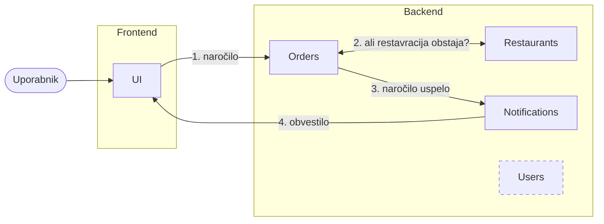
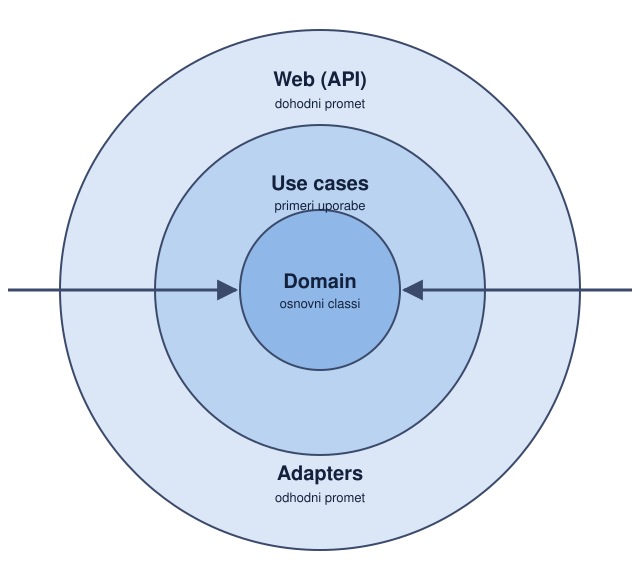
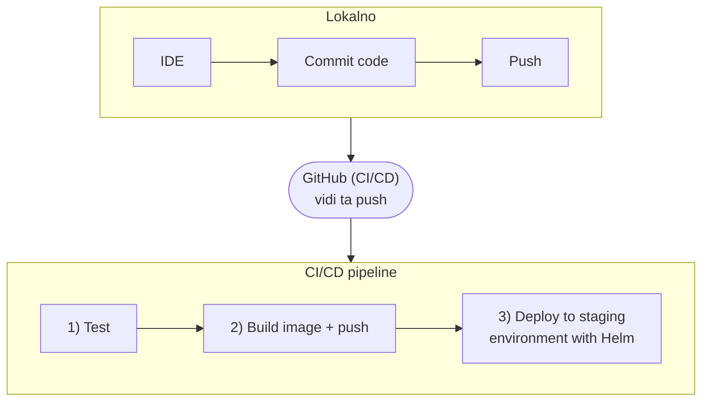

# 1) Demo - bistvo NI koda, ker jo je generiral v Claudu, ampak kako je koda povezana med seboj.

## Zasnova aplikacije
Aplikacija je kot Wolt, Glovo, gremo notr in pogledamo 

Imamo UI, ki je svoja mikrostoritev

*Črtkano: Users (ni del tega toka naročila).*

Katere mikrostoritve so smiselne? Imeli bomo restavracije, ki se morajo hraniti, se pravi imamo mikrostoritev RESTAURANTS. Prav tako imamo naročila, to se rabi nekje beležiti: ORDERS mikrostoritev. Ko narediš naročilo te obvesti, da je naročilo na poti. To je v posebni mikrostoritvi NOTIFICATIONS. Prav tako imamo mikrostoritev USERS, ki hrani vse uporabnike aplikacije.

FLOW: Uporabnik klikne na UI

## + Koda (Clean architecture)

Clean architecture je vizualno kot neka čebula.

*Puščice: zunanji obroči uporabljajo samo notranje.*

Ima jedro in zunanje obroče, vsak od obročev pa ima svoj namen.

Če pogledamo storitev Orders:
- DOMAIN:v jedru so najbolj elementarni classi in funkcije, ki jih potrebujemo. 
- USE CASES/PRIMERI UPORABE: to je drug layer, kjer so vse funkcije, ki jih mikrostoritev nudi in izvaja
- ADAPTER: komunikacija z drugimi mikrostoritvami IN WEB (API): komunikacija z zunanjimi aplikacijami, programi...

**POMEMBNO**: zunanji obroči lahko uporabljajo stvari SAMO IZ NOTRANJIH OBROČEV. Se pravi Web api lahko samo iz use cases uporablja, kar je narejeno.

Vsaka mikrostoritev bo narejena po tem "čebulnem" principu. Mikrostoritve med seboj komunicirajo samo preko public APIjev druge mikrostoritve, se pravi del, ki je izpostavljen drugim mikrostoritvam in navzven.

To je princip clean architecture. Se pravi da NE importamo class iz restaurants mikrostoritve v 

## Ogled

na repotu Cloud-Computing-FRI/delivery-app-restaurants. Se pravi ime_aplikacije-mikrostoritev.

imamo 4 file:
domain (prvi obroč) \
usecases (drugi obroč) \
web (tretji obroč) \
adapters (tretji obroč)

Znotraj domain imamo 2 classa, ki definirata podatke, ki jih hranimo.

Web definira API, kako lahko uporabnik interaktira direktno s to mikrostoritvijo. Ampak ker je ta mikrostoritev v backendu, UI, se pravi frontend dostopa do te backend storitve.

Za komunikacijo MED mikrostoritvami pa bo v "adapters" folderju. Adapters so OUTGOING traffic, Web (API) pa je ingoing traffic.

Na clustrih imamo pode, znotraj katerih imamo image. In znotraj imgeov imamo inmemory, se pravi memory ki je znotraj imaga. Potem imamo zunanjo bazo, do katere lahko dostopamo.

_ToDo, kaj je tukaj mislil:
Če želimo našo aplikacijo postaviti v dev okolju in ne v memory okolju, lahko zamenjamo, da dela in memory, namesto na zunanji bazi, ki je production baza in ima live podatke.

V Helmu obstajajo Templati, v katerih imaš nastavitve za production, development, staging ENVIRONMENTE. In v vsakem YAML filu lahko definiram kaj želim da dela un mikroservice, se pravi tam definiramo IP od podatkovne baze. In lahko definiramo drugo bazo za staging in drug IP za production, v testing environmentu pa lahko definiramo naj in memory testira, zato da se testi hitreje izvajajo.

Kakšne storitve SO in memory, zato da je nizka latenca, ker mogoče sploh ne rabimo azpisovati v bazo. Se pravi če delamo pipeline, namesto da dela request v neko databazo, da dela in memory, samo da vidimo če dela deployment in postavitev.

Naši mikroservici so znotraj ene organizacije.

_ToDo - poglej si strukturo kako je narejena ta organizacija:

github.com/Cloud-Computing-FRI

Ko smo na websitu smo v appu kliknili v UIju z imenom. In takrat je šel request na Orders mikroservice. Ta preveri če obstaja ta restavracija. In ker obstaja je šel notification, ki je posodobil frontend.

Trenutno je zadeva napisana da je HTTP request, se pravi je BLOCKING, dokler ne dobi nazaj notificationa. Ampak je zvibecodano.

Boljši in scalable dizajn bi bil, da UI da event na NATS queue, in je subscriban na event OrderWentThrough in ko ga pošlje Notification microservice, updejta orders na UI frontendu. Se pravi ne čaka noben del aplikacije, ni blocking, ker je naredil HTTP request.

## Deploy (Github, CI/CD, Helm)

Mi kodo urejamo lokalno na IDEju in ko pushamo kodo na github bo Github Actions to videl in se bo izvedel proces CI/CD pipelina.

Se pravi da bo zgradil image in bo pushal ta image na nek repository...

Ta koda deluje tako, da ko se ti odločiš da deluje vse kot mora, da klikneš RunWorkflow, ki bo povleku image iz dockerhuba in ga deploya. Se pravi NE bo še enkrat gradil image, ampak bo vzel že tega, ki je passal teste in smo ga v staging environmentu pregledali in potrdili da deluje.

Ker imamo en repository za eno mikrostoritev, je tako da ena sprememba v repostiriju builda SAMO to mikrostoritev, ostale pusti primeru. To je dobra praksa, ker tako spreminjamo samo našo mikrostoritev, se pravi se updejta samo naš del aplikacije.

delivery-app-restaurants/.github/worklfows/ci-cd.yml

v jobs: so napisana dale, ki jih lahko izvajamo
test je workflow ki testira to mikrostoritev.

build workflow: definira da potrebuje, da je test se zagnal preden se začne buildati, zato da ne moreš zbuildati preden testiraš.

za workflow deploy-staging (staging deployment) potrebujemo da je build se izvedel prej. Ker build workflow zbilda image, ki ga nato deploy potegne dol, brez tega nima nič za potegnit dol in deployati na naš Azure cluster.
Na kateri cluster se pusha (cluster-name) dej tudi kot secret, ker je to javno dostopno in se lahko nekdo z našimi credentials notri prijavi in deploya na naš cluster!

Deploy-prod, kot deploy to production je definiran, da se izvede samo ko mi kliknemo na gumb. Ampak je bug, ker ima needs: test, kar pomeni da lahko testiramo in potem kliknemo deploy, ampak nima image-a, zaradi česar bo failalo, ker ne bo imel nič za potegnit dol. Ampak je pa tako, da ko pushash na github se test in deploy-staging avtomatično izvedeta, tako da rabiš hitro klikniti na deploy-prod, da se image še ni zildal in da bo failalo, ker ne bo imaga in ne bo mogel nič deployati na 

Key secrets za azure credentials in docker credentials, lahko shranimo znotraj organizacije. _ToDo: premisli katere credentials potrebujemo dati na nivo organizacije, in katere 

Secrets & Actions: ACTIONS, sem notri dodaj secrete. Poimenuj jih tako, da bo lahko HELM dostopal do njih!

Ker smo v skupini uporabljamo Azure credentials od 1 osebe! Verjetno vmes ugotoviš ko pišeš CI/CD pipeline, ko ugotoviš kaj rabiš za terminal komando dodati, zato da se izvede pravilno.

Asistent je imel te secrete na nivoju organizacije.
AKS_CLUSTER_NAME
AKS_RESOURCE_GROUP
AZURE_CLIENT_ID
AZURE_SUBSCRIPTION_ID
AZURE_TENANT_ID
DOCKERHUB_TOKEN
DOCKERHUB_USERNAME

Za podatkovne baze:

"azure database for postgres" napiši v portal.azure.com

Znotraj tega lahko kliknemo create, kjer lahko naredimo nov PostgreSQL database. AMPAK PAZI! Dev/Test, pazi na to koliko resursov nas bo stalo, poklikaj, da prideš čist ceneje s ceno! Ampak so dragi podatki.

Če shut downamo postgres bazo, bo še zmeram računalo samo zato da obstaja baza. Se pravi namesto npr. 20$/mesec je 5$/mesec če je baza shut down-ana, ampak obstaja. Verjetno zato, ker še zmeram hrani podatke.

Rešitev: en človek ima database na svojem Azure accountu, drug človek ima cluster na svojem accountu.

In znotraj Azure naklikamo nove podatkovne baze, ker vsak microservice bo imel svojo podatkovno bazo!

---

# 2) Vprašanja + Diskusija

Frontend je svoja mikrostoritev, mi bomo delali react native, kar pomeni da bo frontend v svojem repotu in klicaril preko API callov backend, da dobi vse potrebne podatke.

Multitanent sistem - frend grupe, oziroma faks proti faksu npr. Kjer je en tannent vsi uporabniki/ learnerji enega faksa in drug tannent so vsi uporabniki drugega faksa.

povzamem:
- ideja mu je super
- bistvo mu je, da je funkcionalen pipeline za deployment, da ni prekompleksna aplikacija, da se lahko ukvarjamo z tem
- za backend tehnologijo sem vprašal ker se ne strinjamo pa je rekel da ni problema imamo razlike med mikrostoritvami, dokler vemo kaj se pri komu drugemu v kodi dogaja. Se pravi, da vemo kje je kaj. Če nekdo ne bi znal brati kode, potem imamo problem, ampak itak bo vsak predstalvjal svoje mikrostoritve, tako da ni takega problema.